# ha-github

[](https://www.home-assistant.io/integrations/marketplace/)
[](https://github.com/juju35/ha-github/actions/workflows/hacs.yml)
[](https://github.com/juju35/ha-github/actions/workflows/validate.yml)
[](https://github.com/juju35/ha-github/actions/workflows/lint.yml)
[](https://github.com/juju35/ha-github/releases/latest)
[](https://github.com/juju35/ha-github/blob/main/LICENSE)
[](https://buymeacoffee.com/julienstep9)

<p align="center"></p>

Home Assistant integration for your GitHub repositories: an **admin sidebar panel** to follow them in the GitHub integration and see their open issues and pull requests, and **Lovelace cards** with their stars, forks, open issues and pull requests, latest release and commit.

It works on top of the core [GitHub integration](https://www.home-assistant.io/integrations/github/): no token of its own, entities **discovered automatically**, whatever the language of your installation.

[](https://my.home-assistant.io/redirect/marketplace_repository/?owner=juju35&repository=ha-github&category=integration)

| GitHub panel | GitHub Card |
|---|---|
| 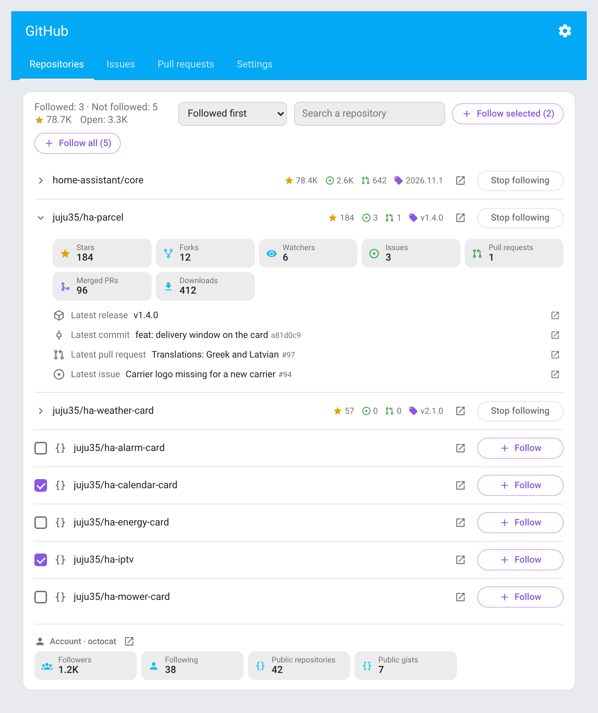 | 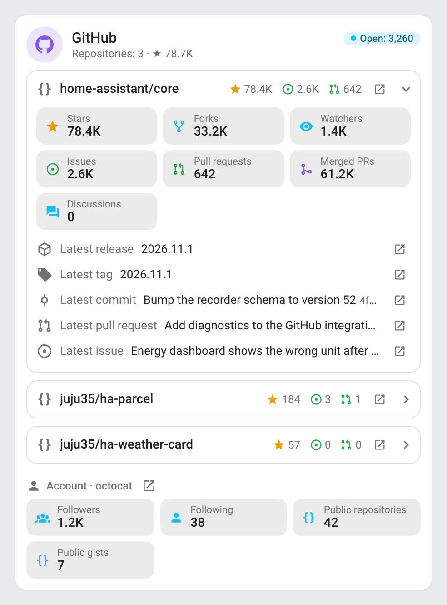 |

## Features

### Sidebar panel (administrators only)

- **Repositories**: every repository of your GitHub account (and your starred ones, if you choose), followed or not by the GitHub integration. Each followed one shows its stars, open issues, open pull requests and latest release on its row, and unfolds the same details as the GitHub Card (counters, latest release, commit, pull request, issue…). The head gives the totals of the followed repositories, and your GitHub account (followers, following, public repositories and gists) closes the list. **Follow** or **Stop following** one, or **Follow all** at once: the whole change reloads the GitHub integration a single time
- **Issues** and **Pull requests**: the open ones of all the followed repositories, most recently updated first, with their repository, number, author, age, comments and labels, and the review state of pull requests (approved, changes requested, review required, draft); filter by repository; each opens on GitHub
- **Settings**: the repositories offered (name patterns such as `juju35/ha-*`, starred repositories, archived repositories ignored), and a Home Assistant notification for each new issue, pull request or release
- Tabs in the address (`/github-config/issues`), so a link or a reload opens the same tab

### Cards

- A full **GitHub Card** and a compact **GitHub Mini Card**, loaded on every dashboard by the integration (no resource to add)
- One foldable section per repository, with its stars, open issues and open pull requests at a glance: one unfolded at a time, folded again on a click elsewhere (a single repository is always unfolded)
- Stars, forks, watchers, open issues, open pull requests, merged pull requests, discussions and downloads of the latest release
- Latest release, tag, commit, pull request, issue and discussion, each with a link to its page on GitHub
- The account: followers, following, public repositories and gists
- Status pill: the open issues and pull requests of the repositories shown, or "Nothing open"; while the integration follows no repository, the cards say so, with a button to the GitHub integration
- **Zoom** on the mini card: a button at the top right switches it to the full card and back; a click on a repository opens the full card on it
- Choose the repositories and their order, or sort them by name, stars or open issues and pull requests
- Visual editor in the dashboard UI for every card (no YAML needed)

### Everywhere

- Light and dark mode, English, French, German, Spanish, Serbian (Cyrillic and Latin), Italian, Dutch, European Portuguese, Polish, Romanian, Danish, Swedish, Bulgarian, Russian, Ukrainian, Hungarian, Slovak, Czech, Slovenian, Latvian and Greek
- No dependency: vanilla JavaScript, and Python with Home Assistant only

## Supported integrations

| Integration | What it is used for |
|---|---|
| [GitHub](https://www.home-assistant.io/integrations/github/) (built in) | The repositories followed (one per "repository" entry of the integration), their sensors for the cards and the notifications, and its access token for the open issues and pull requests |

## Prerequisites

Home Assistant 2026.11 or later, and the [GitHub integration](https://www.home-assistant.io/integrations/github/) added with your GitHub account (**Settings → Devices & services → Add integration → GitHub**). Repositories can then be followed from the panel. The account sensors (followers, following, public repositories and gists) are disabled by default: enable them on the device of your GitHub account to show the **Account** section of the cards.

## Installation

### Via the Marketplace (recommended)

Click the button below to add the repository directly:

[](https://my.home-assistant.io/redirect/marketplace_repository/?owner=juju35&repository=ha-github&category=integration)

Then click **Install** and restart Home Assistant.

Or manually:

1. Open **Settings → Marketplace → Add from link** (top right; this needs a GitHub account connected)
2. Add `https://github.com/juju35/ha-github` — Type: **Integration**
3. Open **GitHub Card** and click **Install**, then restart Home Assistant

Then **Settings → Devices & services → Add integration → GitHub Card**: the **GitHub** entry appears in the sidebar (administrators only), and the cards are available on every dashboard.

### Manual

1. Download `github_card.zip` from the [latest release](https://github.com/juju35/ha-github/releases/latest)
2. Extract it to `/config/custom_components/github_card/`
3. Restart Home Assistant and add the **GitHub Card** integration

### Upgrading from 1.x (dashboard card)

Up to 1.0.1 this repository was a dashboard card. Since 2.0.0 it is an integration that ships the card:

1. In the Marketplace, remove **GitHub Card** (type Dashboard), then add the repository again with the type **Integration** and install it
2. Restart Home Assistant and add the **GitHub Card** integration

The former card resource (`/hacsfiles/ha-github-card/github-card.js` or `/local/community/ha-github-card/github-card.js`) is replaced by the integration's own (`/github_card/github-card.js`) when the integration starts. Card configurations stay the same.

## Panel

The **GitHub** entry of the sidebar, for administrators only.

| Light | Dark |
|---|---|
|  | 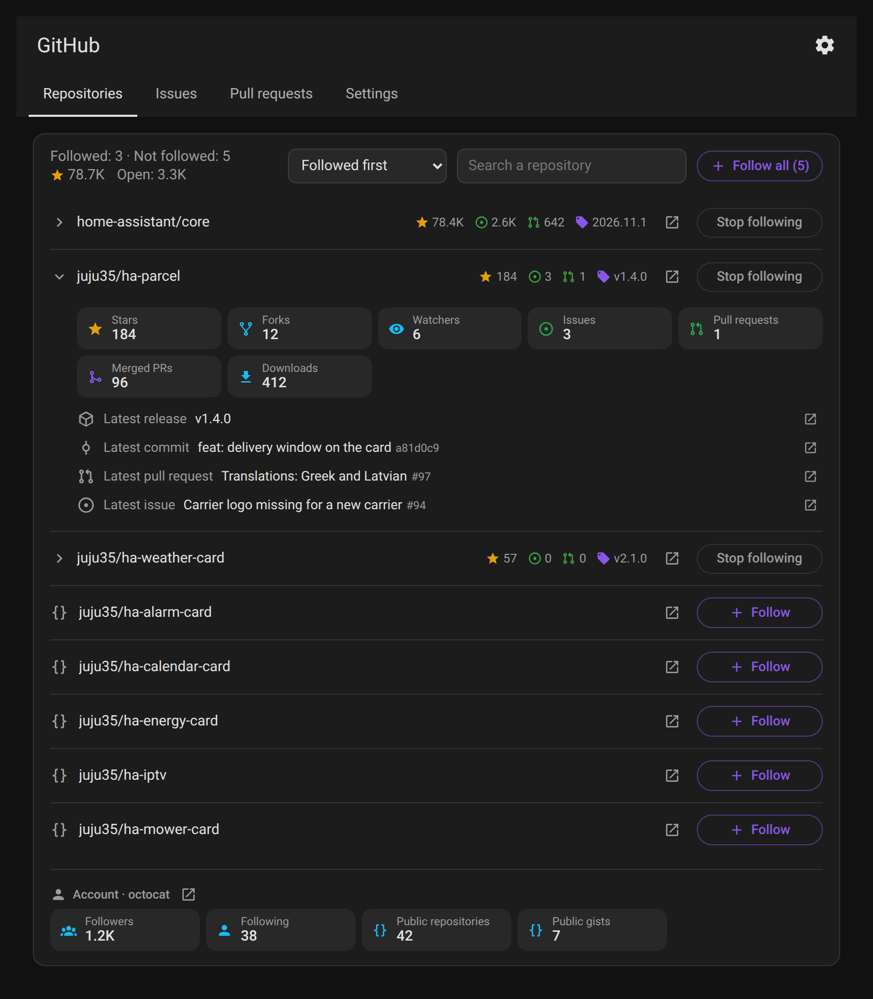 |
| 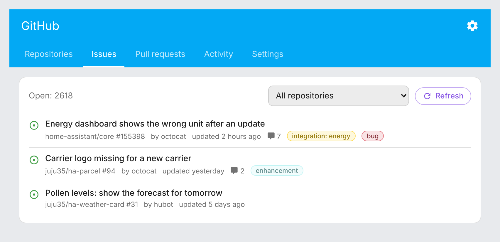 | 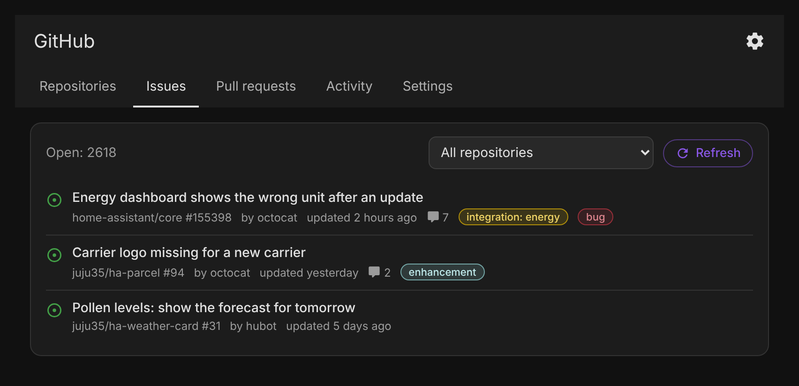 |
| 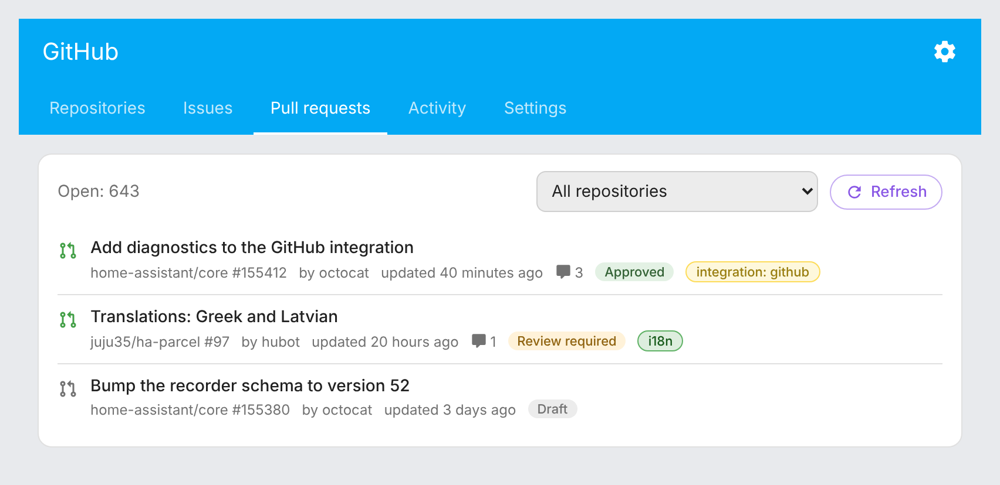 | 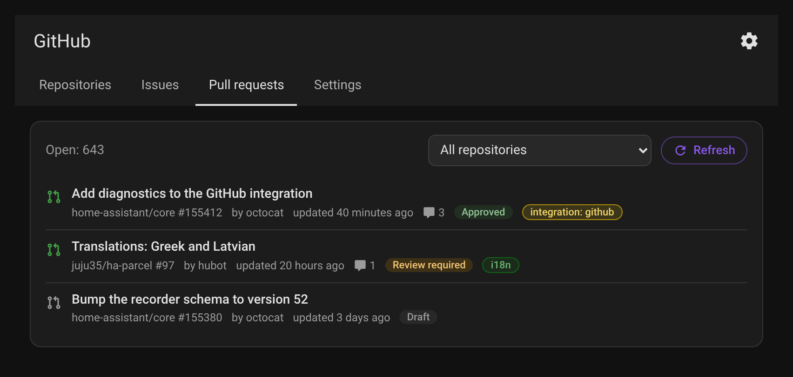 |
| 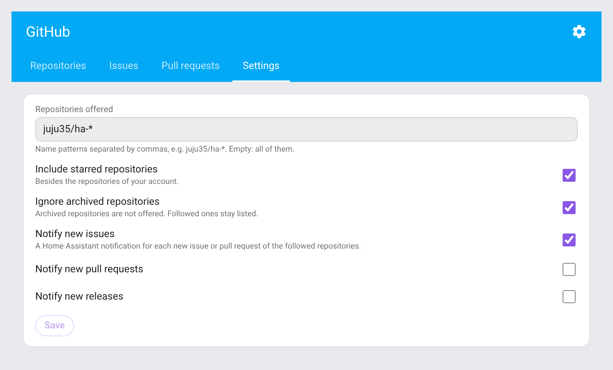 | 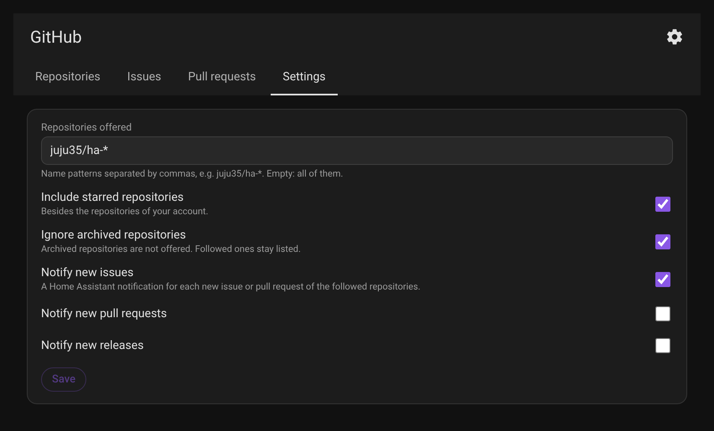 |

### Repositories

The list comes from the GitHub integration's own **Add repository** form: your repositories and your starred ones, read with its token. By default only the repositories of your account are offered; **Settings** can add your starred ones, keep only names matching patterns (`juju35/ha-*, home-assistant/*`) and, with **Ignore archived repositories**, leave out the archived ones (read from the GitHub API with the GitHub integration's token, kept 10 minutes; if GitHub cannot be queried, nothing is hidden). Followed repositories are always listed.

The list is sorted with the menu next to the search field: followed first (default), by name, or the followed repositories by stars, open issues or open pull requests (the choice is remembered in the browser). Each followed repository shows its live counters on its row (stars, open issues, open pull requests, latest release); a click on its name unfolds the GitHub Card's details of that repository under the row, one repository at a time.

**Follow** adds the repository to the GitHub integration exactly as its **Add repository** form does (a "repository" entry). The GitHub integration reloads whenever its repositories change, so the panel makes the whole change at once: **Follow all** with 40 repositories reloads it once, not 40 times. Its sensors are unavailable for a few seconds meanwhile. **Stop following** asks first: the repository's sensors and their history are removed from Home Assistant.

### Issues and pull requests

The GitHub integration only has counts and the latest issue and pull request of a repository. The full lists come from the GitHub GraphQL API, with the **access token of the GitHub integration** (sent to `api.github.com` only, never to the browser): one query for 20 followed repositories at a time, at most 50 open issues and 50 open pull requests per repository, kept for 5 minutes. **Refresh** asks GitHub again.

### Notifications

With **Notify new issues**, **Notify new pull requests** or **Notify new releases** in **Settings**, a Home Assistant notification shows each new issue, pull request or release of a followed repository (one per repository and kind, replaced by the next), with its link. They come from the GitHub integration's **Latest issue**, **Latest pull request** and **Latest release** sensors, refreshed by the GitHub integration itself: a higher number is a new issue or pull request, another tag a new release (a sensor back from unavailable says nothing new).

## Cards


### Visual editor

Edit a dashboard, click **Add card** and search for **GitHub Card** or **GitHub Mini Card**. Set an optional title, pick the repositories, the sort order, the sections to display and the language. The preview updates live, and options left at their default are kept out of the generated YAML.

### Minimal

```yaml
type: custom:github-card
```

```yaml
type: custom:github-mini-card
```

### Full options

```yaml
type: custom:github-card
title: My projects
repositories:
  - home-assistant/core
  - juju35/ha-parcel
sort: stars
show_latest: true
show_account: true
language: fr
```

```yaml
type: custom:github-mini-card
title: My projects
sort: open
max_repos: 5
show_latest: true
show_account: true
zoom: true
language: fr
```

### Options reference

| Option | Card | Default | Description |
|---|---|---|---|
| `title` | all | `GitHub` | Card title |
| `show_title` | all | `true` | Show the title in the header (e.g. `false` under a section heading of your own) |
| `show_subtitle` | all | `true` | Show the subtitle under the title |
| `repositories` | all | All | Repositories to show (`owner/repo`, any case, or the name given to the device), in this order |
| `sort` | all | `name` (the `repositories` order when set) | `name`, `stars` (most starred first) or `open` (most open issues and pull requests first) |
| `show_latest` | all | `true` | Latest release, tag, commit, pull request, issue and discussion of the unfolded repository |
| `show_account` | all | `true` | Account section (full card) and followers (mini card), when the account sensors are enabled |
| `max_repos` | mini | `5` | Repositories listed in the compact view, then "+N" |
| `zoom` | mini | `true` | Zoom button at the top right: shows the full card, and back to the compact view |
| `embed` | full | `false` | Without frame, header or foldable sections: the counters and the latest activity of the repositories listed in `repositories`, then the account unless `show_account: false` (used by the panel) |
| `language` | all | Auto | Force language: `en`, `fr`, `de`, `es`, `sr`, `sr-Latn`, `it`, `nl`, `pt`, `pl`, `ro`, `da`, `sv`, `bg`, `ru`, `uk`, `hu`, `sk`, `cs`, `sl`, `lv` or `el` (auto-detects from HA settings) |

## Screenshots

| Light | Dark |
|---|---|
|  | 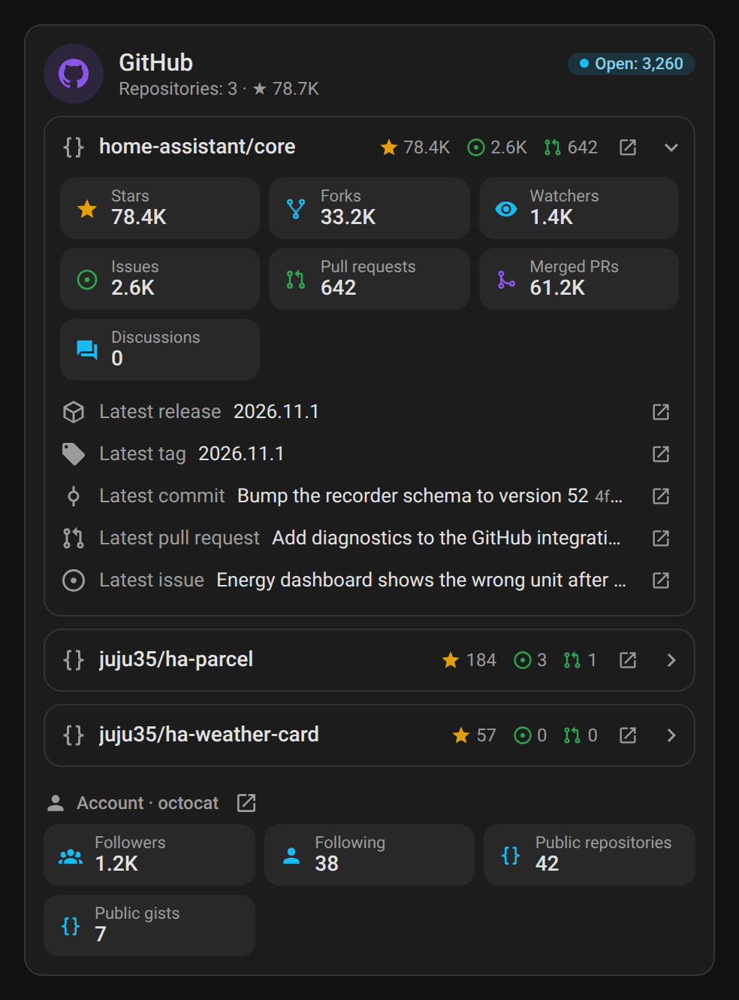 |
| 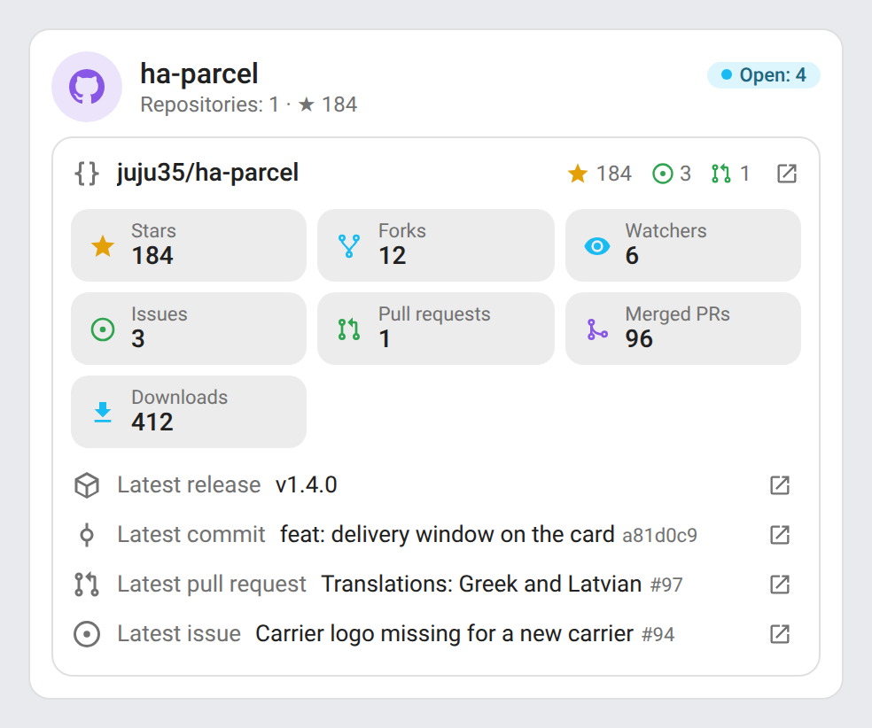 | 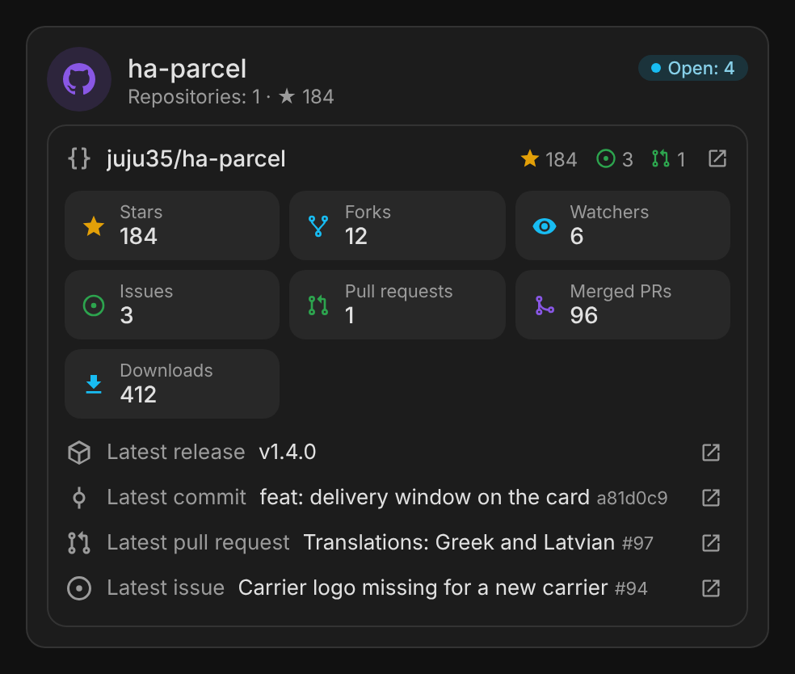 |
| 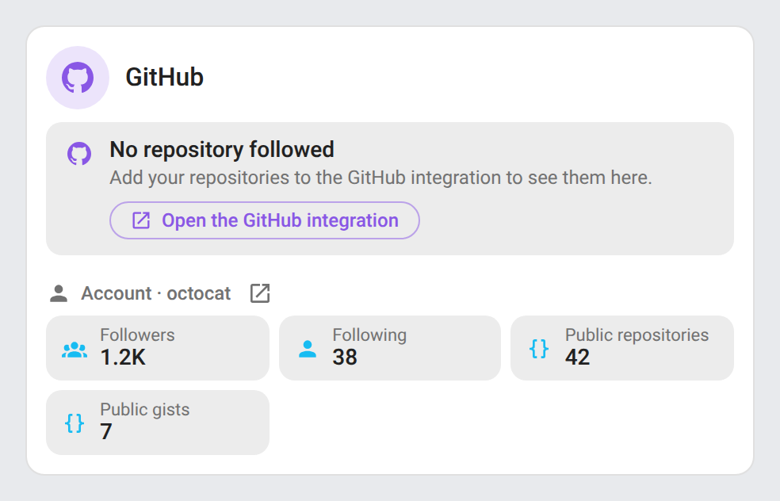 | 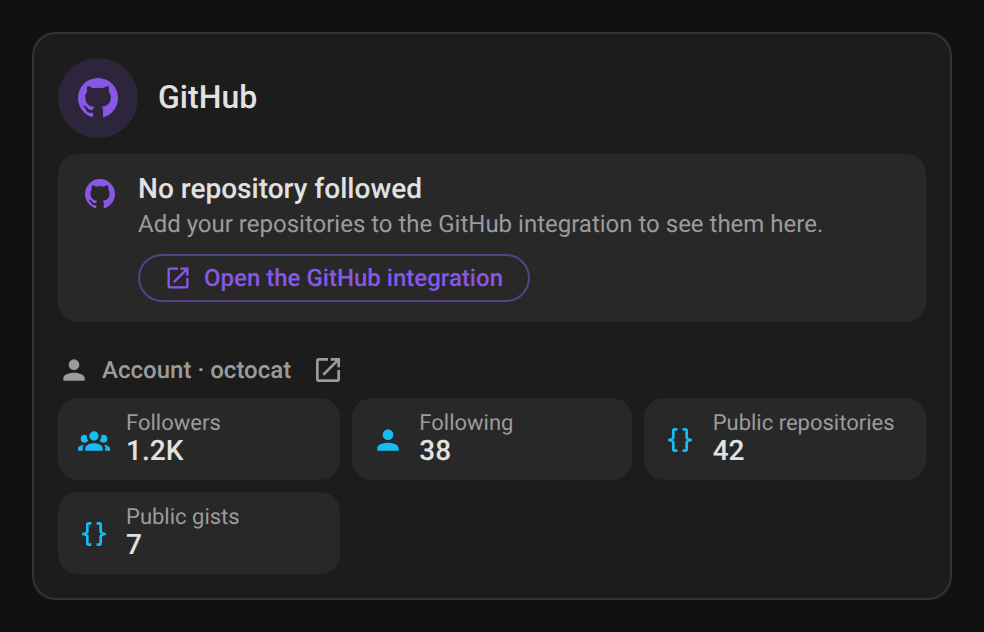 |
| 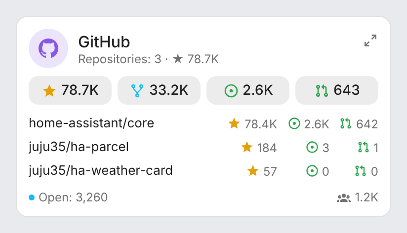 | 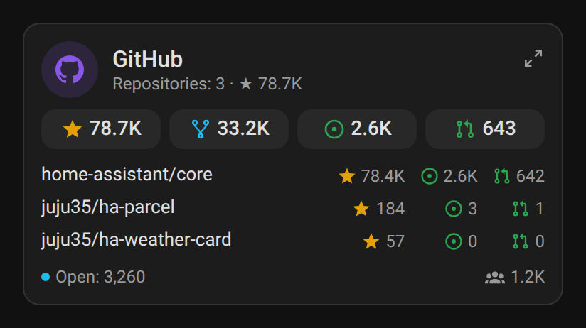 |
| 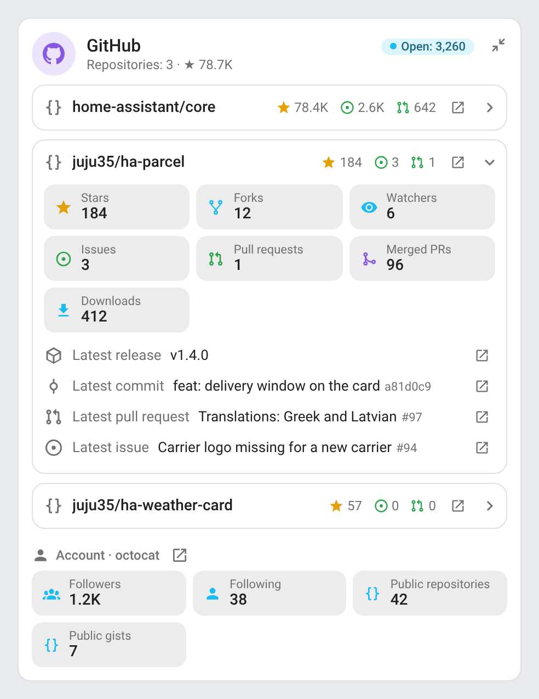 | 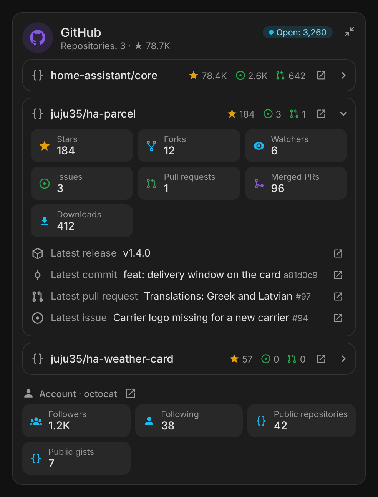 |

## How it works

The cards read the entity and device registries of Home Assistant and keep the sensors of the `github` platform. The integration creates one device per repository, named after its full name (`owner/repo`), and one for the account, named after its login; each sensor is recognized by its translation key (`stargazers_count`, `issues_count`, `latest_release`…), so entity ids translated in another language and renamed entities are supported. When the registry gives no translation key, the end of the English entity id is used instead (`sensor.home_assistant_core_stars`).

The counts of the GitHub integration are the **open** issues and pull requests. The latest release, commit, pull request, issue and discussion come with the link of their page on GitHub (the arrow at the end of the row); a click elsewhere on the row opens the sensor's history.

### Mini card

The compact card shows the totals of the repositories shown (stars, forks, open issues, open pull requests), then one line per repository with its stars, open issues and open pull requests, and the overall status at the bottom. At the far right of the header, a small round button (`mdi:arrow-expand`) shows the full card in its place, with the same options, and turns into `mdi:arrow-collapse` to bring the compact view back; a click on a repository shows the full card with that repository unfolded; a click anywhere outside the card brings the compact view back too, but not a click in a dialog opened from it (more-info). `zoom: false` removes the button, and a click on a repository then opens the history of its stars.

## Development

```bash
pip install -r requirements_test.txt && pytest   # integration tests (Home Assistant test harness)
npm ci && npm test                               # card and panel tests
npm run screenshots                              # renders the cards and the panel with mock data into screenshots/
```

The card and the panel are plain JavaScript files in `custom_components/github_card/frontend/`, served by the integration: nothing to build.

### Releasing

1. Bump the version in `custom_components/github_card/manifest.json`, `const.py` (`VERSION`), `frontend/github-card.js` (`VERSION`), `frontend/github-panel.js` (`GITHUB_PANEL_VERSION`) and `package.json`
2. Add a `## <version>` section at the top of [CHANGELOG.md](https://github.com/juju35/ha-github/blob/main/CHANGELOG.md)
3. Push to `main`: the **Release** workflow checks that the versions agree, creates the tag and the GitHub release with the changelog section as notes, and attaches `github_card.zip`

## Translations

The cards and the panel auto-detect the language from your Home Assistant settings. Currently supported:

| Language | Code |
|---|---|
| English | `en` |
| Français | `fr` |
| Deutsch | `de` |
| Español | `es` |
| Српски | `sr` |
| Srpski (latinica) | `sr-Latn` |
| Italiano | `it` |
| Nederlands | `nl` |
| Português (Portugal) | `pt` |
| Polski | `pl` |
| Română | `ro` |
| Dansk | `da` |
| Svenska | `sv` |
| Български | `bg` |
| Русский | `ru` |
| Українська | `uk` |
| Magyar | `hu` |
| Slovenčina | `sk` |
| Čeština | `cs` |
| Slovenščina | `sl` |
| Latviešu | `lv` |
| Ελληνικά | `el` |

Regional variants fall back to the base language (`it-IT` → `it`, `nl-BE` → `nl`); Brazilian Portuguese (`pt-BR`) uses the European Portuguese translation. Counts read "label: {n}" in every language (`Repositories: 3`, `Open: 12`), so that no plural form is ever wrong.

Contributions for additional languages are welcome!

## License

[MIT](https://github.com/juju35/ha-github/blob/main/LICENSE)

## Support

If you find this project useful, you can support its development:

<a href="https://buymeacoffee.com/julienstep9"></a>
